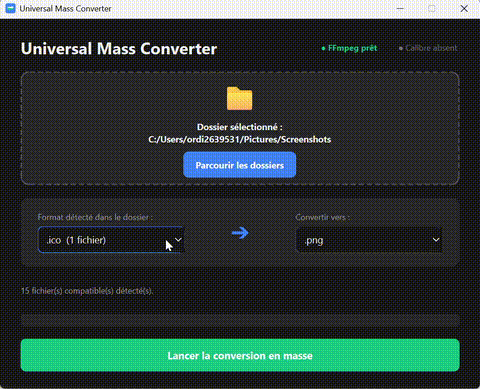

🌐 **English** | **[Français](README_FR.md)**

#  Universal Mass Converter v1.0.0

<p>
  <a href="LICENSE"></a>
  
  
  
</p>

Batch file converter **100% offline, free, and unlimited**. Drag and drop a folder to automatically detect and convert compatible formats.

<p align="center">
  
</p>

<p align="center">
  <a href="https://github.com/BretonB99/Universal-Mass-Converter/releases/download/v1.0.0/UniversalMassConverter.exe">
    
  </a>
  <br>
  <sub><i>Free • No Installation Required • Compatible with Windows 10 & 11</i></sub>
</p>

---

## 🔒 Why use this software instead of an online website?

* **Complete Privacy**: Your documents, photos, and professional files never leave your computer.
* **No Limits**: Convert hundreds of files or several gigabytes at once, with no queues or subscriptions.
* **Native Speed**: Directly leverages your CPU and hard drive power, with zero upload waiting time.

---

## 🚀 Key Features

* **Smart Detection**: Scans the selected folder and displays the exact number of compatible files per extension.
* **Dynamic Menus**: The list of output formats automatically adapts to the selected input format.
* **Smooth Processing**: Background execution with a real-time progress bar and report generation (`rapport_conversion.txt`).
* **Wide Compatibility (50+ formats)**:
  * **Images & Icons**: `.png`, `.jpg`, `.webp`, `.bmp`, `.tiff`, `.ico`, `.heic` (iPhone), `.svg`, `.gif`, and RAW photos (`.cr2`, `.nef`, `.arw`, `.dng`).
  * **Video & Audio**: `.mp4`, `.mkv`, `.avi`, `.mov`, `.webm`, `.mp3`, `.wav`, `.flac`, `.ogg`, audio extraction, and subtitle extraction (`.srt`, `.vtt`).
  * **Subtitles**: `.srt`, `.vtt`, `.ass`, `.ssa`, `.sub`, `.txt`.
  * **Documents & E-books**: `.pdf`, `.docx`, `.md`, `.html`, `.txt`, `.epub` (as well as `.mobi`/`.azw3` if Calibre is installed).
  * **Data & Config**: `.csv`, `.xlsx`, `.json`, `.yaml`, `.xml`, `.toml`.
  * **Archives, Fonts, 3D & GPS**: `.zip`, `.7z`, `.tar.gz`, `.ttf`, `.otf`, `.woff2`, `.stl`, `.obj`, `.gpx`, `.kml`.

---

<details>
<summary><b>📋 Click to display the complete list of conversions (Input ➔ Output)</b></summary>

```text
1. IMAGES, PHOTOS & ICONS
- .png          -> .jpg, .webp, .bmp, .tiff, .ico, .pdf
- .jpg / .jpeg  -> .png, .webp, .bmp, .tiff, .ico, .pdf
- .webp         -> .png, .jpg, .bmp, .ico, .gif
- .bmp          -> .png, .jpg, .webp, .ico
- .tiff         -> .png, .jpg, .webp, .pdf
- .ico          -> .png, .jpg, .webp
- .heic / .heif -> .jpg, .png, .webp, .pdf
- .svg          -> .png, .jpg, .pdf, .ico
- .gif          -> .mp4, .webp, .png
- .cr2 / .nef / .arw / .dng -> .jpg, .png, .tiff

2. VIDEO
- .mp4          -> .mkv, .avi, .mov, .webm, .gif, .mp3, .wav, .srt, .vtt
- .mkv          -> .mp4, .avi, .mov, .webm, .mp3, .wav, .srt, .vtt
- .avi          -> .mp4, .mkv, .mov, .webm, .mp3, .srt
- .mov          -> .mp4, .mkv, .avi, .webm, .gif, .mp3
- .webm         -> .mp4, .mkv, .avi, .mp3, .wav
- .flv / .wmv   -> .mp4, .mkv, .mp3

3. AUDIO
- .mp3          -> .wav, .ogg, .flac, .aac, .m4a
- .wav          -> .mp3, .ogg, .flac, .aac, .m4a
- .flac         -> .mp3, .wav, .ogg, .aac, .m4a
- .ogg          -> .mp3, .wav, .flac, .aac
- .aac / .m4a   -> .mp3, .wav, .ogg, .flac

4. SUBTITLES
- .srt          -> .vtt, .ass, .ssa, .txt
- .vtt          -> .srt, .ass, .txt
- .ass / .ssa   -> .srt, .vtt, .txt
- .sub          -> .srt, .vtt

5. DOCUMENTS & E-BOOKS
- .pdf          -> .png, .jpg, .txt, .docx, .epub
- .docx         -> .pdf, .txt, .md, .html, .epub
- .md           -> .html, .pdf, .docx, .txt
- .html         -> .md, .pdf, .txt
- .txt          -> .pdf, .md, .docx, .epub
- .epub         -> .pdf, .mobi, .azw3, .txt
- .mobi / .azw3 -> .epub, .pdf, .txt

6. DATA & CONFIGURATION
- .csv          -> .xlsx, .json, .xml, .html, .md
- .xlsx         -> .csv, .json, .xml, .pdf
- .json         -> .yaml, .xml, .csv, .toml
- .yaml / .yml  -> .json, .xml, .toml
- .xml          -> .json, .yaml, .csv
- .toml         -> .json, .yaml

7. ARCHIVES, FONTS, 3D & GPS
- .zip          -> .tar, .tar.gz, .7z
- .7z           -> .zip, .tar, .tar.gz
- .tar / .tar.gz -> .zip, .7z
- .ttf          -> .otf, .woff, .woff2
- .otf          -> .ttf, .woff, .woff2
- .woff / .woff2 -> .ttf, .otf
- .stl          -> .obj, .ply, .glb
- .obj          -> .stl, .ply, .glb
- .gpx          -> .kml, .geojson, .csv
- .kml          -> .gpx, .geojson
```
</details>

---

---

## 📦 Installation and Usage

### Option 1: Standalone Version (Windows)
1. Go to the **[Releases](../../releases)** tab on the right side of this page.
2. Download **`UniversalMassConverter.exe`** and run it directly (no Python installation required).

### Option 2: Run from Source Code
1. Get the project:
   * **Via Git**:
     ```bash
     git clone https://github.com
     cd Universal-Mass-Converter
     ```
   * **Via GitHub**: Click the green **Code** button > **Download ZIP**, extract the archive, then open a terminal inside the folder.
2. Install the Python dependencies:
   ```bash
   pip install -r requirements.txt
   ```
3. Launch the application:
   ```bash
   python src/main.py
   ```

### Recommended External Tools (Optional)
* **FFmpeg**: Required only for audio, video conversions, and subtitle extraction (`winget install Gyan.FFmpeg` on Windows) — [See the installation guide](docs/INSTALLATION_FFMPEG.md).
* **Calibre**: Required only to convert to or from Kindle formats (`.mobi`, `.azw3`).

---

<details>
<summary><b>📐 Click to display the full project architecture</b></summary>

```text
Universal-Mass-Converter/
├── src/
│   ├── __init__.py                 # Main package
│   ├── main.py                     # Application entry point
│   ├── config/
│   │   ├── __init__.py
│   │   └── formats.py              # Extension matrix (input -> output)
│   ├── ui/
│   │   ├── __init__.py
│   │   └── main_window.py          # Dynamic graphical interface (PySide6)
│   ├── converters/
│   │   ├── __init__.py
│   │   ├── base_converter.py       # Common base class
│   │   ├── image_converter.py      # Images & Icons
│   │   ├── media_converter.py      # Audio, Video & subtitle extraction
│   │   ├── subtitle_converter.py   # Subtitles
│   │   ├── document_converter.py   # Documents & E-books
│   │   ├── data_converter.py       # Data & Configuration
│   │   └── extra_converter.py      # Archives, Fonts, 3D, GPS
│   └── utils/
│       ├── __init__.py
│       ├── file_scanner.py         # Folder extension detection
│       └── logger.py               # Operation logging
├── tests/
│   ├── __init__.py
│   ├── test_formats.py
│   └── test_converters.py
├── assets/
│   ├── badge-mit.svg
│   ├── badge-mit-en.svg
│   ├── badge-offline.svg
│   ├── badge-offline-en.svg
│   ├── badge-python.svg
│   ├── badge-ui.svg
│   ├── btn-download.png
│   ├── btn-download-en.png
│   ├── icon.ico
│   ├── icon.png
│   ├── screenshot.png
│   └── screenshot_video.gif
├── docs/
│   └── INSTALLATION_FFMPEG.md
├── .gitignore
├── LICENSE
├── modification_futur.md
├── pyproject.toml
├── README.md
├── README_FR.md
└── requirements.txt
```
</details>

---

## 🗺️ Planned Evolutions
Check the [modification_futur.md](modification_futur.md) file to discover the features planned for upcoming versions.

---

## 🗒️ License
This project is distributed under the **MIT License**. See the [LICENSE](LICENSE) file for more details.
